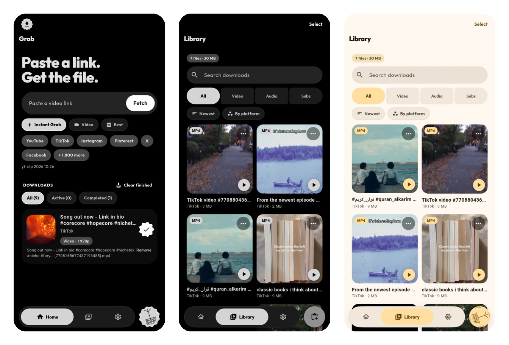
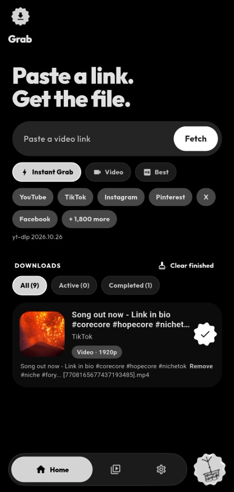
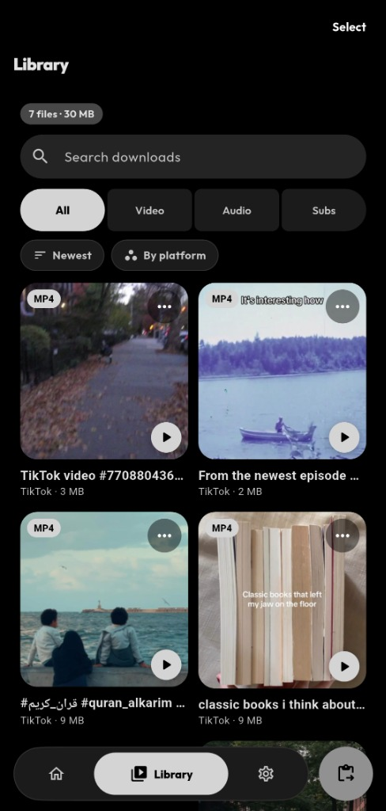
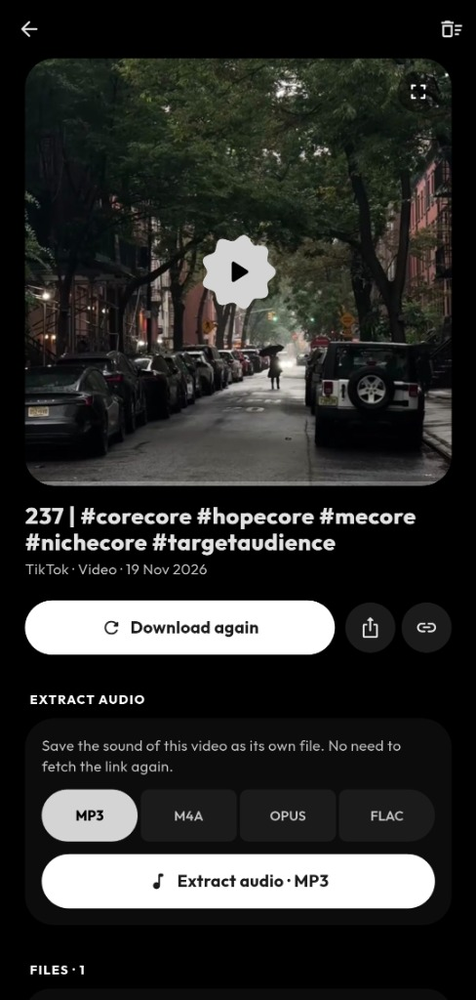
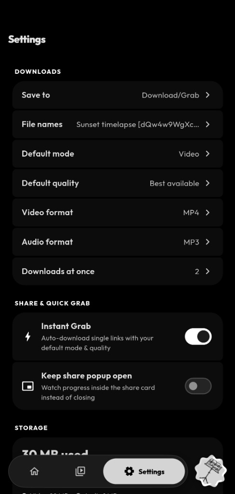
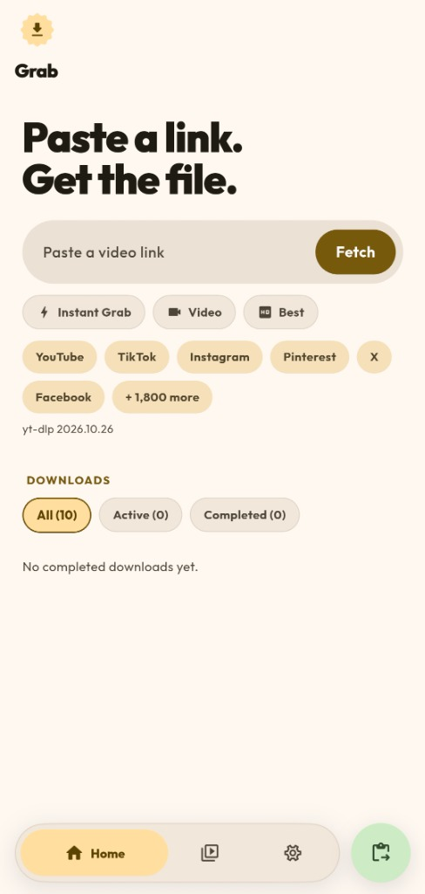
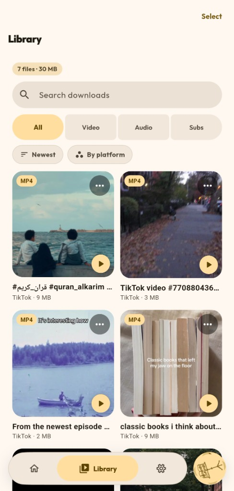

<div align="center">


# Grab Expressive

**Paste a link. Get the file. — Material 3 Expressive Edition**

A free, open-source Android app for saving video, audio, and subtitles from TikTok, YouTube, Instagram, Pinterest, X, Facebook, and [1,800+ other sites](https://github.com/yt-dlp/yt-dlp/blob/master/supportedsites.md) — rebuilt with a Google **Material 3 Expressive** design system, a **Koda-style floating dock & shape-morphing Companion Orb**, a **translucent floating share card**, and **zero-window silent Instant Grab**.

[](LICENSE)
[](#install)
[](https://github.com/Mhmdysry/grab/releases/latest)
[](https://flutter.dev)
[](https://github.com/yt-dlp/yt-dlp)

[About This Fork](#about-this-fork) · [Features](#features) · [Screenshots](#screenshots) · [Install](#install) · [Changelog](CHANGELOG.md) · [Build from source](#build-from-source) · [Architecture](#architecture)

<br>



</div>

---

## About This Fork

**Grab Expressive** ([`Mhmdysry/grab`](https://github.com/Mhmdysry/grab)) is an enhanced fork of [`Asta39/grab`](https://github.com/Asta39/grab). It retains the zero-server, zero-tracking, on-device [`yt-dlp`](https://github.com/yt-dlp/yt-dlp) + [`FFmpeg`](https://ffmpeg.org) engine while re-architecting the UI, sharing workflow, navigation, and reliability:

| Area | Upstream (`Asta39/grab`) | **Grab Expressive (`Mhmdysry/grab`)** |
| --- | --- | --- |
| **Design System & Customization Studio** | Static Yellow/Ink "Pop" palette | **Full Material 3 Expressive Studio**: 9 curated M3 seed palettes, Android 12+ wallpaper **Dynamic Color**, 4 scheme variants (`Expressive`, `Vibrant`, `Tonal`, `Mono`), **AMOLED Pure Black** mode, 3 contrast levels (`Standard`, `Medium`, `High`), spring physics presets (`Expressive`, `Standard`, `Snappy`, `Off`), corner shape styles (`Expressive`, `Balanced`, `Crisp`), card density (`Compact`, `Cozy`, `Spacious`), 2/3-column Library grid, and app-wide font scaling |
| **Navigation & Companion Orb** | 4-tab frosted glass dock | **Koda-Style 3-Tab Floating Pill Dock** (**Home**, **Library**, **Settings**) where labels expand only on the active tab with distinct per-tab micro-animations (spring bounce on Home, wave-tilt on Library, 180° gear spin on Settings) + **Revolving Material 3 Polygon Companion Orb** (`cookie9` → `sunny` → `clover` → `pentagon` → `pill` → `squircle`) with full-bleed rotating album art inside a fixed progress ring (and 1-tap clipboard paste when idle) |
| **Sharing from Other Apps** | Opens the full main app | **Translucent Floating Share Card (`ShareActivity`)** rendered directly over TikTok/YouTube/Instagram with quick Video/Audio/Quality chips and expandable Trim/Subtitles/Playlist options **OR** **Zero-Window Silent Instant Grab** that downloads in the background with native Android Toast notifications without opening any window |
| **Home & Library Workflow** | Separate Downloads tab; clearing finished downloads removed them from Library | **Unified Home Downloads** with filter chips (`All`, `Active`, `Completed`) and spring **swipe gestures** (swipe right to Pause/Resume/Retry, swipe left to Cancel/Remove). **Clear finished** hides cards from Home while preserving all saved files, thumbnails, and metadata in the **Library** (with automatic disk-folder recovery via `mergeDiskFiles`) |
| **Audio & Detail Experience** | Standard progress slider | **Dynamic Artwork Color Extraction** on Detail & Audio Player screens, **M3 Expressive Wavy / Squiggly Audio Scrubber**, 1-tap quick-play on Library thumbnails, storage summary pill, and dedicated native audio preview in download details |
| **In-App Updates & Diagnostics** | Basic `ACTION_VIEW` APK intent | **Verified `PackageInstaller.Session` Updater** (`MODE_FULL_INSTALL`) with archive verification, exact Android installer status feedback, persistent release keystore signing for seamless in-place updates, and a built-in 3-tab **Debug & Logcat Viewer** (`Settings → About → Debug log`) |

---

## Overview

Grab Expressive runs [yt-dlp](https://github.com/yt-dlp/yt-dlp) and [FFmpeg](https://ffmpeg.org) directly on your Android phone through [youtubedl-android](https://github.com/yausername/youtubedl-android). No server, no account, no ads, and no tracking: links are fetched straight from the source site, and files are saved to `Download/Grab` (or a folder you choose) on your device.

## Features

### Sharing & Instant Grab
- **Translucent Floating Share Card:** Share a link from TikTok, YouTube, Instagram, or X to open a compact floating M3 Expressive card right over the app you're using—pick Video/Audio/Quality, expand for Trim/Subtitles/Playlist items, and auto-return to your app.
- **Zero-Window Silent Instant Grab:** Turn on **Instant Grab** (on the Home screen, floating card, or Settings) so sharing a link starts downloading immediately in the background with native Android Toast feedback and zero UI interruption.
- **1-Tap Companion Orb Paste & Quick Settings Tile:** Tap the idle Companion Orb or the Android Quick Settings tile to grab whatever link is on your clipboard.

### Downloading
- **Four modes:**
  - **Video + audio:** the video with its sound, plus a separate extracted audio file
  - **Video:** the video with its sound
  - **Audio:** the soundtrack only (MP3, M4A, Opus, FLAC)
  - **Subs:** subtitles only (`.srt` or embedded)
- **Formats and sizes up front:** pick a resolution/quality and see the estimated file size before you download.
- **Preview and frame-accurate trim:** play the clip inside the format sheet and drag the trim handles to save only the segment you want.
- **Playlists, channels, and profiles:** paste a playlist or profile and pick which items to grab.
- **Swipe gestures on download cards:** swipe right to Pause/Resume/Retry; swipe left to Cancel/Remove with haptic detents.
- **Survives bad connections:** interrupted downloads wait for connectivity and retry automatically.

### Library & Audio Player
- **Persistent Library with disk recovery:** clearing finished items on Home never wipes your Library; files in your save folder on disk are automatically discovered and merged.
- **1-Tap Quick-Play & Storage Summary:** see total file count and disk usage in the Library header, filter by media type, sort by newest/oldest/largest/site, and group by platform.
- **Dynamic Artwork Theming & Wavy Scrubber:** the Audio Player and Detail pages adapt their M3 palette to the media's cover art and feature an expressive animated wavy scrubber.
- **Background audio player & Ringtone maker:** lock-screen media controls, mini-player orb integration, one-tap audio extraction from saved videos, and a 40-second ringtone cutter.

### Material 3 Expressive Customization Studio
- **Palettes & Dynamic Color:** 9 curated M3 Expressive palettes (`Grab Amber`, `Coral`, `Violet`, `Emerald`, `Cobalt`, `Rose`, `Tangerine`, `Teal`, `Slate`), Android 12+ wallpaper Dynamic Color, 4 scheme variants (`Expressive`, `Vibrant`, `Tonal`, `Mono`), AMOLED Pure Black mode, and 3 contrast levels.
- **Motion, Shapes & Layout:** choose spring physics (`Expressive`, `Standard`, `Snappy`, `Off`), corner geometry (`Expressive`, `Balanced`, `Crisp`), navigation bar style (`Floating`, `Docked`, `Minimal`), card density (`Compact`, `Cozy`, `Spacious`), 2- or 3-column Library grid, and font scale.

---

## Screenshots

<table>
  <tr>
    <td align="center"><br><b>Home & Unified Downloads</b><br><sub>Instant Grab bar, unified queue & Koda-style dock (AMOLED Mono)</sub></td>
    <td align="center"><br><b>Persistent Library (Dark)</b><br><sub>Quick-play thumbnails, storage pill & platform grouping</sub></td>
    <td align="center"><br><b>Download Detail & Extract Audio</b><br><sub>Polygon play button, one-tap MP3/M4A/Opus/FLAC extraction</sub></td>
  </tr>
  <tr>
    <td align="center"><br><b>Settings & Quick Grab</b><br><sub>Instant Grab, Share popup controls & revolving Companion Orb</sub></td>
    <td align="center"><br><b>Grab Amber (Light Mode)</b><br><sub>Material 3 Expressive tonal surfaces & 1-tap paste orb</sub></td>
    <td align="center"><br><b>Library (Light Mode)</b><br><sub>Expressive palette with rotating artwork Companion Orb</sub></td>
  </tr>
</table>

---

## Install

Download the latest version from [**Releases**](https://github.com/Mhmdysry/grab/releases/latest):

| Platform | Download | Requirements |
| --- | --- | --- |
| **Android (64-bit, most phones)** | [`grab-expressive-v…-arm64-v8a.apk`](https://github.com/Mhmdysry/grab/releases/latest) | Android 7.0 (API 24) or newer |
| **Android (32-bit / x86_64)** | [`grab-expressive-v…-armeabi-v7a.apk`](https://github.com/Mhmdysry/grab/releases/latest) · [`x86_64.apk`](https://github.com/Mhmdysry/grab/releases/latest) | Android 7.0 (API 24) or newer |
| **macOS** | [`grab-macos.dmg`](https://github.com/Mhmdysry/grab/releases/latest/download/grab-macos.dmg) | macOS 12 or newer, Apple silicon or Intel |
| **Windows** | [`grab-windows-x64.zip`](https://github.com/Mhmdysry/grab/releases/latest/download/grab-windows-x64.zip) | Windows 10 or 11, 64-bit |

### Android
Open the APK and allow your browser or file manager to install apps when asked. Subsequent updates install cleanly in place from inside the app (**Settings → About → Check now**), preserving all downloads, settings, and history.

### macOS
1. Open `grab-macos.dmg` and drag **Grab** into **Applications**.
2. The first time, right-click Grab in Applications and choose **Open** (the app isn't notarized by Apple yet).
3. On first launch, Grab automatically downloads `yt-dlp` (and `FFmpeg` if not already installed).

### Windows
1. Unzip `grab-windows-x64.zip` anywhere (for example, `Documents\Grab`).
2. Run `Grab.exe`. If SmartScreen warns about an unknown publisher, choose **More info → Run anyway**.
3. On first launch, Grab automatically fetches `yt-dlp` and `FFmpeg` into its folder.

---

## Build from source

**Prerequisites:** Flutter (stable), Android SDK with platform 37, JDK 17. For desktop: Xcode (macOS) or Visual Studio with C++ (Windows).

```bash
git clone https://github.com/Mhmdysry/grab.git
cd grab
flutter pub get
dart run build_runner build
flutter build apk --release --split-per-abi
```

Desktop:

```bash
flutter build macos --release        # on macOS
macos/dmg/make_dmg.sh build/macos/Build/Products/Release/Grab.app grab-macos.dmg
flutter build windows --release      # on Windows
```

The [Android & Release workflow](.github/workflows/android.yml) chains the [Desktop workflow](.github/workflows/desktop.yml) automatically so every release publishes Android APKs, `grab-macos.dmg`, and `grab-windows-x64.zip` together.

APKs are output to `build/app/outputs/flutter-apk/`.

> [!NOTE]
> Code shrinking (`minify`/`shrinkResources`) is disabled on purpose because `youtubedl-android` uses reflection (Jackson) and native Python archive loading.

---

## Architecture

```text
lib/
├── app/            App shell, Koda-style floating dock, shape-morphing Companion Orb, Riverpod providers
├── core/
│   ├── audio/      Background audio playback (just_audio + audio_service)
│   ├── log/        Persistent rolling AppLog (main + shareMain) & crash capture
│   ├── theme/      Material 3 Expressive theme builder, motion tokens & dynamic artwork color extraction
│   ├── update/     GitHub Release fetcher & PackageInstaller.Session bridge
│   ├── utils/      Link extraction, permissions, haptics & line-art covers
│   └── widgets/    Expressive polygons, wavy progress bars, collapsing headers & morph containers
├── data/
│   ├── db/         Drift SQLite database (WAL/busy_timeout across main and shareMain isolates)
│   ├── engine/     Dart bridge to yt-dlp and FFmpeg
│   ├── repositories/  Download queue, auto-retry & cross-engine sync
│   └── settings/   Material 3 Expressive preferences & persistence
└── features/
    ├── detail/     Artwork-tinted download detail page, audio preview & ringtone cutter
    ├── downloads/  Swipeable download cards & status badges
    ├── home/       Unified Home screen, Instant Grab mode bar, format & playlist sheets
    ├── library/    Persistent Library with disk-folder merge, video player & wavy-scrubber audio player
    ├── settings/   Settings, Appearance & Customization Studio, About & 3-tab Debug/Logcat screen
    ├── share/      Translucent floating ShareOverlayApp & headless zero-window silent Instant Grab
    └── welcome/    First-run onboarding
android/app/src/main/kotlin/app/grab/grab/
├── MainActivity.kt          Primary AudioServiceActivity host
├── ShareActivity.kt         Translucent floating share overlay & zero-window silent Instant Grab dispatcher
├── EnginePlugin.kt          yt-dlp & FFmpeg bridge with cross-engine sync & silent-fetch keepalive
├── DownloadService.kt       Foreground dataSync service and progress/completion notifications
├── AppPlugin.kt             PackageInstaller.Session updater, Dynamic Color & Logcat reader
├── UpdateInstallReceiver.kt BroadcastReceiver for PackageInstaller session status callbacks
├── HapticsPlugin.kt         Android haptic primitives
├── RingtonePlugin.kt        Ringtone cutting and system ringtone setting
└── GrabTileService.kt       Quick Settings clipboard tile
```

## Testing

```bash
flutter analyze --no-fatal-infos
flutter test
```

## Acknowledgements

- Original [**Grab**](https://github.com/Asta39/grab) project by [**Asta39**](https://github.com/Asta39).
- Powered by [yt-dlp](https://github.com/yt-dlp/yt-dlp), [FFmpeg](https://ffmpeg.org), and [youtubedl-android](https://github.com/yausername/youtubedl-android).

## License

Grab Expressive is licensed under the [GNU General Public License v3.0](LICENSE).

> [!IMPORTANT]
> Download only content you have the right to save, and follow each site's terms of service. Grab Expressive is not affiliated with any of the sites it supports.
